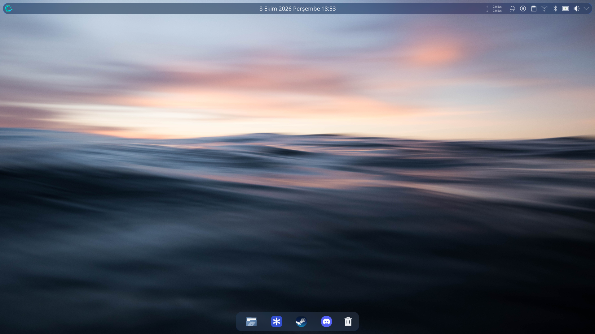

# TNFX-Plasma

A portable KDE Plasma 6 desktop configuration: Nord colors, Utterly-Round style, a floating top bar and a bottom dock.

## Preview



## What's inside

| Part | Value |
|------|-------|
| Global theme | Utterly-Nord (bundled) |
| Plasma style | Utterly-Round (bundled) |
| Colors | UtterlyNord (bundled) |
| Window decoration | Utterly-Round-Dark, Aurorae (bundled) |
| Application style | Breeze |
| Icons | Breeze Dark |
| Cursor | Breeze Light |
| Splash screen | CachyOS-Nord |
| Widgets | Simple Kickoff, Window Title, Net Speed (bundled) |
| Wallpaper | Aritim Dark (bundled, also used on the lock screen) |
| KWin | Blur, inactive window translucency, 2 virtual desktops, tiling layout |
| Default apps | Terminal: kitty, browser: Helium |

Also included: keyboard shortcuts, window rules, mouse settings and GTK 3/4 settings matched to the Plasma look.

Everything is copied straight from a working CachyOS / Plasma 6 setup. It includes `~/.config/kdedefaults/`, which holds the values the global theme applies. Without that folder the decoration and the splash fall back to defaults.

## Install

```bash
git clone https://github.com/TNFX1/TNFX-Plasma.git
cd TNFX-Plasma
./install.sh
```

The script:

1. Backs up every file it will overwrite to `~/.config-TNFX-Plasma-backup-<timestamp>/`.
2. Stops plasmashell, because a running plasmashell writes its own panel layout back over the new one.
3. Copies `config/` (including `kitty/kitty.conf`) to `~/.config/`, and `local-share/` plus the wallpaper to `~/.local/share/`, then binds the desktop to your current activity.
4. Replaces `/home/<username>` with your home folder.
5. Restarts plasmashell.

After that, **log out and back in** so the cursor, GTK settings and shortcuts apply.

To undo, copy the backup folder back: `cp -r ~/.config-TNFX-Plasma-backup-<timestamp>/. ~/.config/`

## Optional

- **Splash screen**: CachyOS-Nord comes from the `cachyos-nord-kde-theme-git` package. On other distros the default splash is used.
- **Weather widget**: set your location from its settings.
- **Lock screen**: if it does not pick up the wallpaper, set it in System Settings → Screen Locking → Appearance.
- **Displays**: `kdeglobals` and `kwinrc` include scaling for `eDP-1` / `HDMI-A-1` (XWayland scale 1.15). Adjust them in System Settings → Display if your screens differ.

## Requirements

- KDE Plasma 6 (tested on 6.7.5, CachyOS)
- kitty and `JetBrainsMono Nerd Font`, if you want the default terminal to work as configured
- `fish`, `starship`, `eza` and `zoxide` for the terminal look (prompt, icons in `ls`); kitty is set to run fish if it is installed

## Licenses

The bundled themes and widgets are GPL. Each one keeps its own license file inside its folder under `local-share/`:

- [Utterly-Nord / Utterly-Round](https://store.kde.org/p/2135625/) (GPL-2.0+)
- Simple Kickoff (GPL-2.0+), Window Title (GPL-2.0), Net Speed Widget (GPL-2.0)
